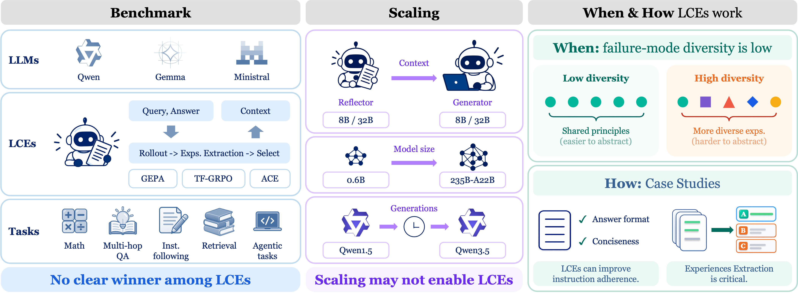

# Revisiting LLMs as Context Engineers

Junrui Zhang<sup>1</sup>, Zeyu Xu<sup>2</sup>, Runchuan Zhu<sup>1</sup>, Jie Peng<sup>2</sup>, Long Zhang<sup>2</sup>, Zixin Ding<sup>3</sup>, Jiaxin Lin<sup>4</sup>, Kai Wang<sup>1</sup>, Jianmin Ji<sup>2</sup>, Junyuan Hong<sup>1</sup>

<sup>1</sup>National University of Singapore &nbsp; <sup>2</sup>University of Science and Technology of China &nbsp; <sup>3</sup>University of Chicago &nbsp; <sup>4</sup>Independent Researcher

Correspondence: Junyuan Hong (jyhong@nus.edu.sg)



*Overview of our work. We investigate whether LCEs can engineer effective context and further examine the mechanisms underlying their successes and failures.*

## Abstract

As large language models (LLMs) are used in more and more new tasks, context engineering becomes a fundamental
method to efficiently steer LLMs by constructing instruction prompts or metadata without intensive training.
A growing number of LLM context engineering (LCE) approaches automate the task by casting the LLM itself as the
engineer that draws generalizable instructions or experiences from offline trials as context. Although these
methods resemble how humans learn from experiences, it remains unclear **when and how** LLMs can engineer effective
context from data. To answer the question, we first establish a benchmark composed of datasets with different
reasoning patterns. We compared different LCE methods with different LLM families in 8B size, showing that there is
no single winner for all tasks, even compared with simple baselines like chain-of-thought. Even when scaling model
capabilities via more parameters or generation iterations, LCEs do not consistently boost existing performance.
Across all datasets and models, the performance gains of LCEs are negatively correlated (r = −0.5, p ≤ 0.05) with
the diversity of the failure modes of reasoning trajectories. Investigating how LCEs work, we find that (1) the
improvement in instruction adherence can explain some success of LCEs; (2) one major bottleneck is whether LLMs
can extract effective experiences out of natively diverse failures. Through this study, we uncover the limited
capabilities of LCEs in abstracting principled contexts from diverse failure modes and understand how LCEs work,
providing guidelines for future work.


## Contributions

- **LLMs can** engineer contexts via task-specific training, but no single method can achieve the best performance in all datasets at test time.

- **Scaling** helps but cannot reverse existing failures of LCEs. Even scaling to newer generations and more parameters remains insufficient to make LCEs more effective across different settings.

- **When & How:** Through aggregate analysis, we find that LCEs work better when facing less diverse failure modes of reasoning. Case studies show that the ability to abstract principled contexts from heterogeneous failures is the major bottleneck and that the success of some LCE methods is attributed to the improvement in adherence to (format) instruction rather than reasoning.


## Installation

Prepare the experimental environment:

```bash
conda create -n lce python=3.12 -y
conda activate lce
pip install -r requirements.txt
```


## Experimental Setup

```
benchmarks/    datasets + scoring shared by the three methods (IFBench checkers, MATH verifier, ...)
data/          train / val / test splits
gepa_dspy/     run.py (optimization loop), tasks.py (DSPy programs and feedback metrics); not named
               "gepa" so that it does not shadow the gepa package used by DSPy
ace/           run.py, ace.py (training loop), generator / reflector / curator, bullet de-duplication
tfgrpo/        run.py (rollouts, validation, test), experiences.py (teacher updates), prompts.py, tasks.py
failure_modes/ run.py (extracts the failure mode of each failed trajectory), prompts.py, example.jsonl,
               vendi.py (Vendi Score per setting and its correlation with the LCE performance gains)
scripts/       serve_qwen.sh, run.sh (4 tasks x 5 seeds), summarize.py (scores and gains, mean over seeds)
```

| Method | Context | Entry point |
|---|---|---|
| [GEPA](https://arxiv.org/abs/2507.19457) | the instruction of the task program | `python -m gepa_dspy.run` |
| [ACE](https://arxiv.org/abs/2510.04618) | a playbook of bullet points (generator / reflector / curator) | `python -m ace.run` |
| [Training-Free GRPO](https://arxiv.org/abs/2510.08191) | an experience library learned from groups of rollouts | `python -m tfgrpo.run` |

| Dataset | Task | `--task` |
|---|---|---|
| [HotpotQA](https://arxiv.org/abs/1809.09600) | multi-hop question answering over the given gold and distractor Wikipedia paragraphs | `hotpotqa` |
| [IFBench](https://arxiv.org/abs/2507.02833) | instruction following under verifiable output constraints | `ifbench` |
| [MATH500](https://huggingface.co/datasets/HuggingFaceH4/MATH-500) | competition-level math problems | `math500` |
| [MiddleMatch](https://arxiv.org/abs/2512.14982) | name the person between two given names in a list of 40 names | `middlematch` |

## Training

*LCEs* and *Scaling* (Section 4): No single winner for all tasks, while scaling does not enable LCEs to consistently boost existing performance. Our main experimental results can be reproduced by replacing the LLMs.

Serve the model with vLLM:

```bash
MODEL=Qwen/Qwen3-8B PORT=8000 bash scripts/serve_qwen.sh
MODEL=/path/to/Qwen3-8B SERVED_NAME=Qwen/Qwen3-8B PORT=8000 bash scripts/serve_qwen.sh   # local weights
```

All 4 tasks x 5 seeds (seeds run as parallel processes, logs in `logs/<method>/`):

```bash
bash scripts/run.sh gepa
bash scripts/run.sh ace
bash scripts/run.sh tfgrpo
TASKS="math500" SEEDS="0 1" bash scripts/run.sh tfgrpo     # subset
```

A single run:

```bash
python -m gepa_dspy.run --task hotpotqa --student_lm Qwen3-8B --teacher_lm Qwen3-8B --seed 0
python -m ace.run       --task ifbench  --student_lm Qwen3-8B --teacher_lm Qwen3-8B --seed 0
python -m tfgrpo.run    --task math500  --student_lm Qwen3-8B --teacher_lm Qwen3-8B --seed 0
```

The *student* model solves the task; the *teacher* model performs the optimization (GEPA reflection LM, ACE
reflector + curator, TF-GRPO experience updates). They can be different models on different servers:
`--student_api_base http://host:8000/v1 --teacher_api_base http://host:8001/v1`
(`STUDENT=Qwen3-8B TEACHER=Qwen3-32B STUDENT_API_BASE=... TEACHER_API_BASE=... bash scripts/run.sh ...`).

## Outputs

Every run writes to `outputs/<method>/<task>/T-<teacher>_S-<student>/`.

`python scripts/summarize.py --csv gains.csv` aggregates the seeds and outputs the results as follows:

```
method   task         setting                             test (%)    gain  seeds
tfgrpo   hotpotqa     T-Qwen3-8B_S-Qwen3-8B          38.00 ±  0.97    0.00  5
gepa     hotpotqa     T-Qwen3-8B_S-Qwen3-8B          32.80 ±  0.99   -1.54  5
ace      hotpotqa     T-Qwen3-8B_S-Qwen3-8B          33.67 ±  0.97   -3.26  5
```


For comparison, the paper reports the following results (Qwen3-8B as both student and teacher, mean ± std over
5 seeds); a reproduction is expected to fall within the seed variance:

| Dataset | TF-GRPO | GEPA | ACE |
|---|---|---|---|
| HotpotQA | 38.00 ± 0.97 | 32.80 ± 0.99 | 33.67 ± 0.97 |
| IFBench | 32.21 ± 1.58 | 33.30 ± 3.64 | 32.17 ± 1.28 |
| MATH500 | 82.10 ± 2.43 | 80.60 ± 1.43 | 63.80 ± 2.93 |
| MiddleMatch | 37.73 ± 8.57 | 42.33 ± 3.80 | 25.20 ± 3.96 |


## Failure Mode Analysis

*When & How* (Section 5): LCEs gain more when facing less diverse failure modes. For each failed training trajectory, an LLM writes one sentence describing the reusable failure mode. Then, these sentences are
embedded with `all-mpnet-base-v2` and their diversity is measured by the Vendi Score, which is negatively
correlated with the performance gains of the LCEs.

```bash
MODEL=Qwen/Qwen3.8-27B PORT=8000 bash scripts/serve_qwen.sh      # the extractor used in the paper
VLLM_BASE_URL=http://localhost:8000/v1 python -m failure_modes.run \
    --input failure_modes/example.jsonl --output failure_mechanisms.jsonl
```

The input JSONL has one failed trajectory per line; see `failure_modes/example.jsonl` for an example.

The output has one line per input record, in input order. For the first record of `failure_modes/example.jsonl`, the paper run
produced:

```jsonl
{"method": "ACE", "model": "Qwen3-8B", "dataset": "math500", "failure_mechanism": "The model applied the required delimiting operation to only a component of the tuple instead of the entire coordinate pair, violating the instruction to box the final answer."}
```

`failure_modes/vendi.py` reports the mean and std of the Vendi Score and prints the Pearson r and the p-value:

```bash
python scripts/summarize.py --csv gains.csv
python -m failure_modes.vendi --input failure_mechanisms.jsonl --gains gains.csv --output failure_vendi.csv
```

The output `failure_vendi.csv` has one row per setting (`method`, `model`, `dataset`, `n_failures`, `vendi_mean`,
`vendi_std`, `gain`). The script also prints the correlation between the Vendi Score and the LCE performance gains:

```
Wrote 45 settings to failure_vendi.csv
ACE: n=15 r=-0.372 p=0.0860
GEPA: n=15 r=-0.556 p=0.0158
TFGRPO: n=15 r=-0.512 p=0.0256
LCEs: n=45 r=-0.464 p=0.0007
```

The `LCEs` line corresponds to Figure 5: a negative r (r = −0.5, p ≤ 0.05 in the paper) means that the LCEs gain
more when the failure modes are less diverse.

## Citation

```bibtex
@article{zhang2026revisiting,
  title   = {Revisiting LLMs as Context Engineers},
  author  = {Zhang, Junrui and Xu, Zeyu and Zhu, Runchuan and Peng, Jie
             and Zhang, Long and Ding, Zixin and Lin, Jiaxin and Wang, Kai
             and Ji, Jianmin and Hong, Junyuan},
  journal = {arXiv preprint arXiv:2611.30494},
  year    = {2026}
}
```

## License

This project is released under the [MIT License](LICENSE). Third-party code retains its original licenses and copyright notices.
